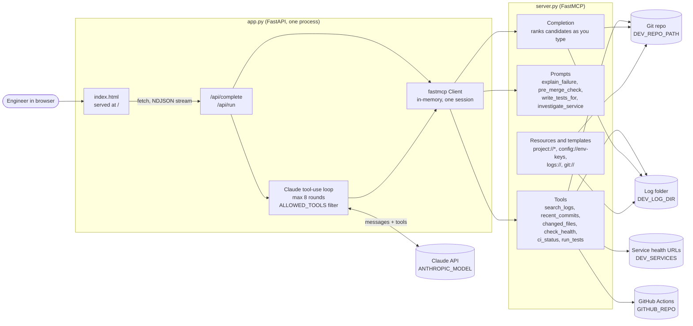
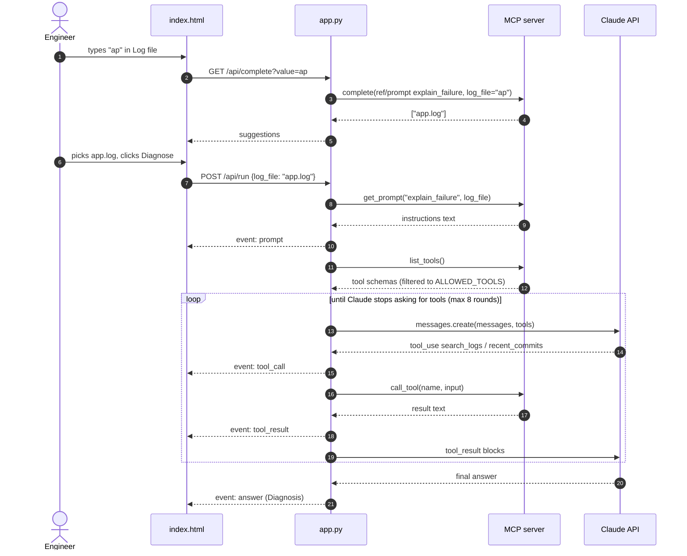
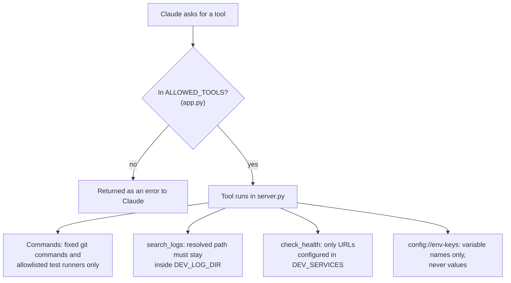

# dev-companion architecture

dev-companion has two parts: an MCP server (`server.py`) that wraps everyday engineering work, and a one-page web app (`app.py` + `index.html`) that uses it to answer "Why did this fail?" for a log file.

The diagrams below use Mermaid. They render in GitHub, GitLab and VS Code (with the built-in Markdown preview or a Mermaid extension).

## Components

The MCP server runs **in-process**: `app.py` imports `server.mcp` and connects with `fastmcp.Client(mcp)`, so there is no subprocess or network hop between them. The same `server.py` also runs on its own over stdio (`uv run server.py`), which is how Claude Code or Claude Desktop would connect to it.

## Request flow: diagnosing a log file

The page reads the response as newline-delimited JSON and renders each event as it arrives, so the audience sees every tool call live.

## The three MCP features the demo shows

| Feature | Where it happens | Why it matters |
|---|---|---|
| **Completion** | `@mcp.completion` in `server.py`, called from `/api/complete` | The server, not the UI, knows which log files, branches, commits and services exist. Any MCP client gets the same suggestions. |
| **Prompt** | `@mcp.prompt explain_failure` | The investigation steps live on the server. Improve the prompt once and every client picks it up, with no app redeploy. |
| **Tools** | `@mcp.tool` functions, called by Claude through the loop in `app.py` | Claude decides which tools to call and in what order; the app only executes them and streams progress. |

## Security boundaries

- **Least privilege in the app.** The web page only diagnoses, so `run_tests` is left out of `ALLOWED_TOOLS`, even though the server offers it.
- **No shell.** Every command is an argument list passed to `subprocess.run` without a shell, from a fixed set.
- **Path traversal blocked.** `search_logs("../server.py")` returns "Not found", which the smoke tests check.
- **Bounded output.** Tool output is truncated (8,000 characters) before it reaches Claude, and the loop stops after 8 rounds.
- **Secrets.** The API key lives in a gitignored `.env`, loaded with `uv run --env-file .env`. Nothing in the server reads or returns secret values.

## Configuration

| Variable | Used by | Purpose |
|---|---|---|
| `ANTHROPIC_API_KEY` | app.py | Claude API key (required for Diagnose) |
| `ANTHROPIC_MODEL` | app.py | Model for the loop, default `claude-sonnet-5-5` |
| `DEV_REPO_PATH` | server.py | Git repo the tools operate on, default current directory |
| `DEV_LOG_DIR` | server.py | Log folder, default `<repo>/logs` |
| `DEV_SERVICES` | server.py | JSON map of service name to health URL |
| `GITHUB_REPO`, `GITHUB_TOKEN` | server.py | Enable `ci_status` |

## Where this goes next

- **Shared server:** switch to the HTTP transport (`mcp.run(transport="http")`) with authentication so a team uses one hosted instance.
- **More connectors:** Jira tickets, database schemas, Kubernetes pods, each with autocomplete.
- **One page for every prompt:** build the form from `list_prompts()` instead of hard-coding `explain_failure`.
